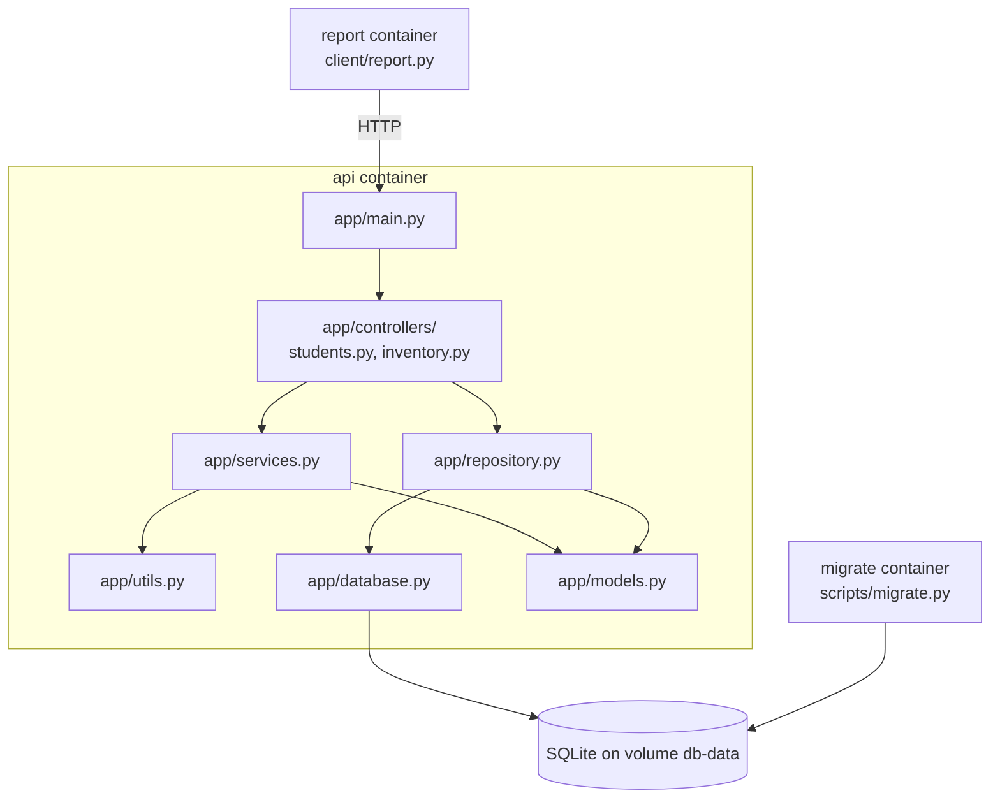

# School Ops (Student Records + Inventory)

A modular Python application, built for the **SEN 401 Software Configuration
Management & Maintenance** lab at MIVA Open University.

Author: Temidayo Omoyajowo (2025/B/SENG/0513)

**Requires Python 3.12+** (since v1.1).

| Version | Lab | Summary |
|---------|-----|---------|
| v1.0 | Lab 1 | Baseline student records console app |
| v1.1 | Lab 2 | Corrective, adaptive, perfective and preventive maintenance |
| v2.0 | Lab 4 | Re-engineered: merged with the inventory app (Lab 3), modularised, migrated to SQLite + FastAPI, deployed with Docker Compose |

## Architecture (v2.0)



Reverse-engineering notes and UML diagrams: [`docs/lab4/reverse-engineering.md`](docs/lab4/reverse-engineering.md).

## Project structure

```
├── app/
│   ├── main.py              # FastAPI app and /health
│   ├── controllers/         # REST endpoints: /students, /inventory
│   ├── services.py          # Business rules (grades, statistics, low stock)
│   ├── repository.py        # Generic SQLite CRUD repository
│   ├── database.py          # Connection and schema
│   ├── models.py            # Pydantic schemas
│   ├── sources.py           # Legacy JSON/CSV readers
│   └── utils.py             # Generic helpers (highest_by, lowest_by, describe)
├── scripts/migrate.py       # JSON/CSV -> SQLite migration with verification
├── client/                  # Report client service (Dockerfile + report.py)
├── data/                    # Legacy source data: students.json, inventory.csv
├── tests/                   # pytest: unit + end-to-end API tests
├── tools/analyze.py         # Static analysis used for reverse engineering
├── Dockerfile               # API image (also used by the migrate job)
├── docker-compose.yml       # migrate + api + report
├── requirements.txt         # Runtime dependencies
└── requirements-dev.txt     # + test dependencies
```

## Run with Docker Compose

```bash
docker compose up --build          # migrate -> api -> report
# API docs: http://localhost:8000/docs
docker compose run --rm report     # print the reports again
docker compose down                # stop (add -v to delete the database volume)
```

## Run locally

```bash
python3.12 -m venv .venv && source .venv/bin/activate
pip install -r requirements-dev.txt
python -m scripts.migrate          # creates data/school_ops.db
uvicorn app.main:app --reload      # http://127.0.0.1:8000/docs
python client/report.py            # in another terminal
pytest -v
```

## API

| Method | Path | Description |
|--------|------|-------------|
| GET | `/health` | Liveness check |
| GET / POST | `/students` | List / create students |
| GET | `/students/stats` | Mean, median, std dev, pass rate, highest, lowest |
| GET / PUT / DELETE | `/students/{id}` | Read (with grade) / replace / delete |
| GET / POST | `/inventory` | List / create items |
| GET | `/inventory/stats` | Total value, units, highest/lowest stock, low stock |
| GET | `/inventory/low-stock?threshold=10` | Items to reorder |
| GET / PUT / DELETE | `/inventory/{id}` | Read (with value) / replace / delete |

## Branching model (SCM)

| Branch | Purpose |
|--------|---------|
| `main` | Protected. Release baselines only; changes arrive through a reviewed pull request. |
| `dev` | Integration branch for completed work. |
| `feature/*` | New features (e.g. `feature/reengineering`), merged into `dev`. |
| `maint/*` | Maintenance against a released baseline. |
| `maintenance` | Lab 2 maintenance work leading to v1.1. |

Baselines are tagged (`v1.0`, `v1.1`, `v2.0`), and each has release notes in `docs/release-notes/`.
