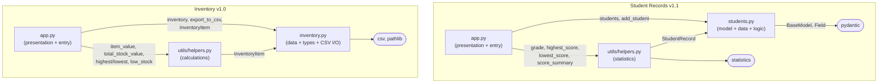
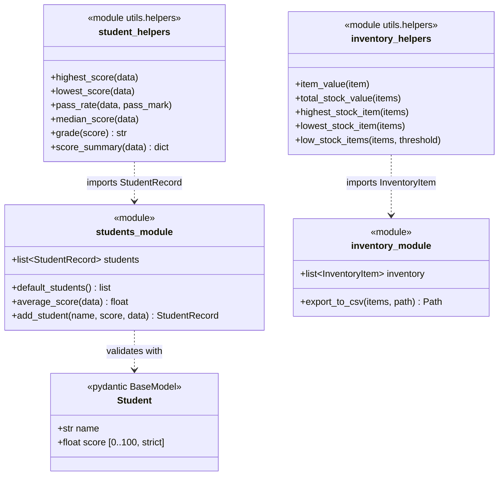
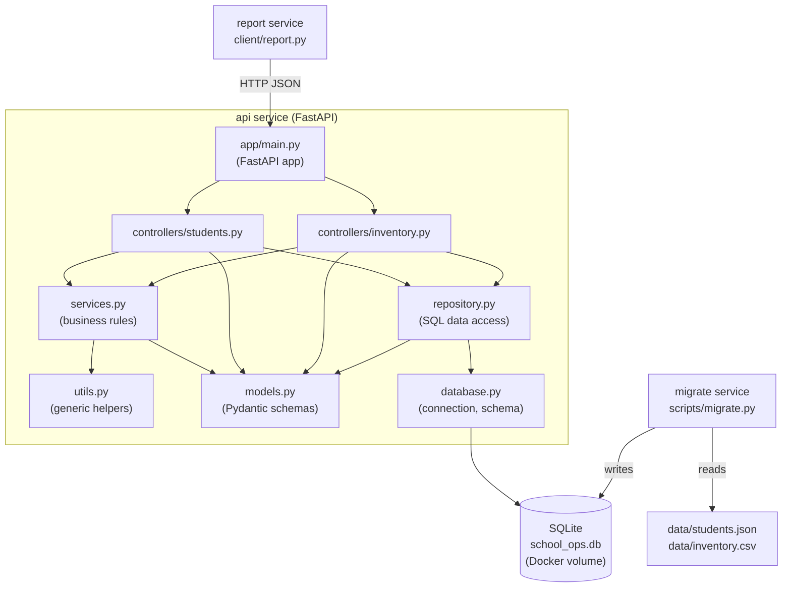

# Lab 4 — Reverse Engineering Notes

**Subject systems:**
- Student Records v1.1 (`sen401-student-records`, Labs 1–2)
- Inventory v1.0 (`sen401-inventory-csa`, Lab 3)

**Method:** Static analysis with `tools/analyze.py`, which parses every module with
Python's `ast` module and reports classes, functions, docstrings, project
imports, module-level side effects and use of global state. Its output was then
checked by reading the code by hand.

```bash
python3.12 tools/analyze.py . ../sen401-inventory-csa
```

## 1. Inventory of functions and classes

### Student Records v1.1

| Module | Element | Kind | Responsibility |
|--------|---------|------|----------------|
| `app` | `print_table` | function | Presentation: ranked table of students |
| `app` | `print_summary` | function | Presentation: statistics summary |
| `app` | `main` | function | Entry point; also **adds a student** (business action) |
| `students` | `Student` | class (Pydantic) | Validation model |
| `students` | `StudentRecord` | type alias | `dict[str, str \| float]` |
| `students` | `default_students` | function | Hard-coded sample data |
| `students` | `students` | module variable | Shared mutable in-memory list |
| `students` | `average_score` | function | Statistic |
| `students` | `add_student` | function | Validate and append (writes to the global list by default) |
| `utils.helpers` | `highest_score`, `lowest_score`, `pass_rate`, `median_score`, `grade`, `score_summary` | functions | Statistics |

### Inventory v1.0

| Module | Element | Kind | Responsibility |
|--------|---------|------|----------------|
| `app` | `print_stock_table`, `print_stock_levels`, `main` | functions | Presentation and entry point |
| `inventory` | `InventoryItem` | type alias | `dict[str, str \| int \| float]` |
| `inventory` | `inventory` | module variable | Hard-coded in-memory list |
| `inventory` | `export_to_csv` | function | File input/output |
| `utils.helpers` | `item_value`, `total_stock_value`, `highest_stock_item`, `lowest_stock_item`, `low_stock_items` | functions | Calculations |

## 2. Module dependency diagrams (current state)



## 3. UML class diagram (current state)



## 4. Coupling and code smells found

| # | Finding | Where | Impact | Planned refactoring |
|---|---------|-------|--------|---------------------|
| 1 | **Utility layer depends on the data layer:** `utils.helpers` imports its type from `students` / `inventory` | both apps | Helpers can't be reused without the data module; dependencies point the wrong way | Move the types into `models.py`; helpers depend only on models |
| 2 | **Mixed responsibilities:** `students.py` holds the model, data and logic; `inventory.py` holds the data, types and CSV I/O | both apps | Changing storage means editing business code | Separate `models`, `repository` (storage) and `services` (logic) |
| 3 | **Duplicated logic (DRY):** `highest_score`/`highest_stock_item` and `lowest_score`/`lowest_stock_item` are the same algorithm on different keys | across apps | Same fix needed in two places | One generic `highest_by(items, key)` / `lowest_by(items, key)` in `utils.py` |
| 4 | **Shared mutable global state:** `students` list is changed by `add_student` | `students.py` | Hidden coupling; state lost on exit; not safe with multiple users | Persist in SQLite and access through a repository |
| 5 | **Hard-coded data:** sample lists in source code | both apps | Changing data needs a code change and a release | Migrate data to SQLite (`scripts/migrate.py`) |
| 6 | **Presentation mixed with business actions:** `main()` adds a student while printing a report | student `app.py` | The report has a side effect | Expose actions as REST endpoints; the report becomes a separate client |
| 7 | **Untyped records:** records are plain `dict`s with string keys | both apps | Typos in keys only fail at runtime; no editor support | Pydantic models for input and output |
| 8 | **No external interface:** console only | both apps | Can't be used by other systems | FastAPI REST API with OpenAPI docs |

## 5. Target architecture (after re-engineering)



The dependencies now point one way: controllers → services/repository → models/database.
`utils.py` and `models.py` depend on nothing else in the project.
